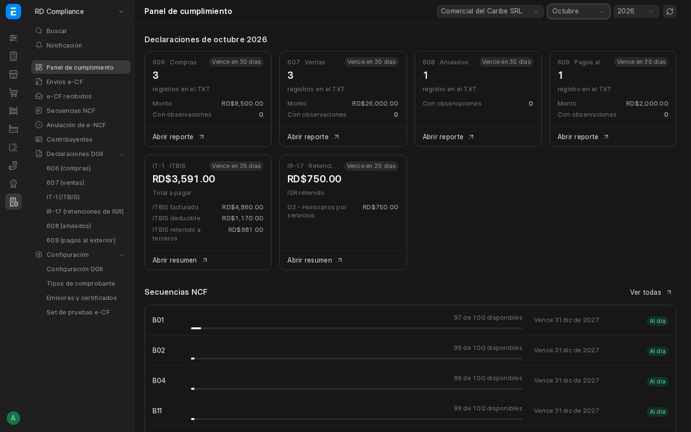
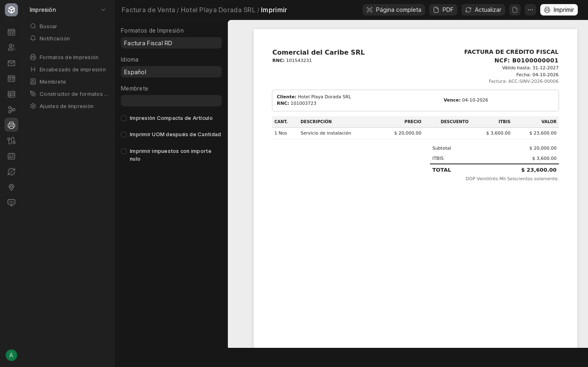
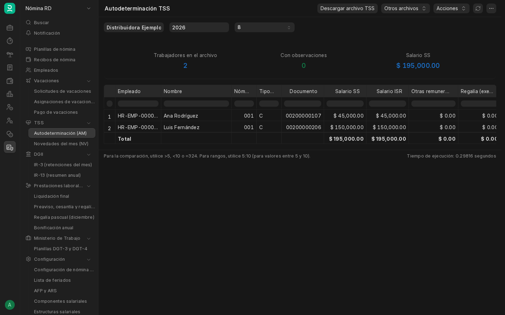
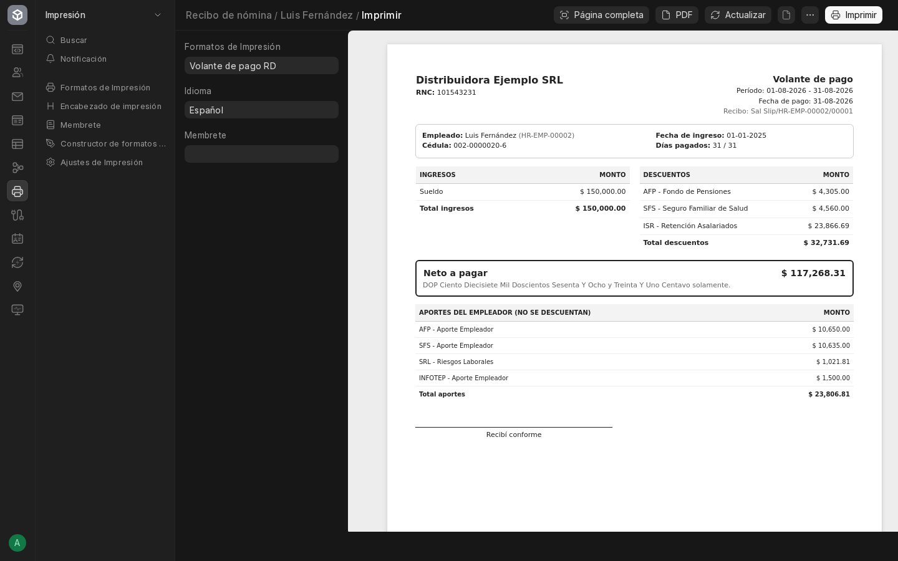

# ERPNext RD

Localización de **República Dominicana** para ERPNext v16 y Frappe HR, libre y de código abierto (GPL-3.0). Adapta lo que ya traen ERPNext y Frappe HR a las normas dominicanas (DGII, TSS, Código de Trabajo) en vez de reemplazarlo: agrega campos, configuraciones y cálculos sobre sus propios documentos.

## Del lado de ERPNext: cumplimiento fiscal (dock de ERPNext → *RD Compliance*)



- **DGII Fiscal**: tipos de comprobante (B01–B17, E31–E47), secuencias NCF sin duplicados, NCF en ventas, compras y POS (las devoluciones toman la nota de crédito B04/E34 solas), validación de RNC y Cédula, catálogo de cuentas DGII (NIIF PYMES) con plantillas de ITBIS y retenciones, formatos de impresión fiscales editables en el constructor de Frappe, con un formato de factura por empresa.
- **DGII Reportes**: formatos 606, 607, 608 y 609 con descarga del TXT oficial, y resúmenes de apoyo para el IT-1 y el IR-17.
- **Padrón RNC**: padrón de contribuyentes de la DGII (cada día a las 2:00 a. m. revisa si la DGII publicó uno nuevo y solo entonces lo descarga) y autocompletado de la razón social.
- **Panel RD Compliance** (*RD Compliance → Panel de cumplimiento*, dentro del escritorio; también en `/rd-compliance`): en una pantalla, los plazos y montos del 606, 607, 608, 609, IT-1 e IR-17 del mes, las secuencias NCF por agotarse o vencer y los registros con observaciones antes de enviarlos. Hecho con [frappe-ui](https://ui.frappe.io), el mismo estilo del escritorio de Frappe v16.
- **Feriados de RD**: una lista de feriados de ERPNext, *Feriados RD*, con los feriados dominicanos y sus traslados según la Ley 139-97 (los toma de la misma librería que usa el botón "Agregar feriados locales" de ERPNext) y el domingo como día de descanso. Se crea sola, se extiende cada año hasta el 31 de diciembre del año siguiente y queda como lista por defecto de las empresas RD que no tengan otra. Lo que edites a mano (por ejemplo, un decreto que mueva un feriado) se respeta.
- **e-CF** (facturación electrónica directa con la DGII): XML de los diez tipos (E31 a E47) y del resumen de consumo (RFCE) según los esquemas oficiales, firma digital con el certificado .p12 de la empresa, envío y consulta del resultado, reenvío automático en contingencia y entrega al comprador. Recepción de e-CF de proveedores con acuse de recibo y aprobación o rechazo comercial, anulación de rangos de e-NCF y set de pruebas para la certificación (CerteCF). Falta la certificación ante la DGII con un certificado real.



## Del lado de Frappe HR: Nómina RD (dock de Frappe HR → *Nómina RD*)



Opcional: se activa sola si Frappe HR está instalado (antes o después) y se retira si se desinstala.

- **Recibo de nómina**: AFP, SFS e ISR del empleado y aportes del empleador (SFS, AFP, SRL, INFOTEP), con topes de la TSS.
- **Prestaciones**: preaviso, cesantía y regalía proporcional al salir; vacaciones por aniversario y su pago al salir.
- **Regalía pascual de diciembre**: se calcula y se crea en bloque para pagarla en el recibo de diciembre.
- **Bonificación anual** (participación en los beneficios): reparte el 10 % de la utilidad con el tope de 45 o 60 días y la paga en la nómina, con el 0.5 % de INFOTEP.
- **Horas extras**: sobre las de Frappe HR, con el valor de la hora y los recargos de ley (35 %, 100 % sobre 68 horas semanales y en feriados, y 15 % más en la jornada nocturna).
- **Volante de pago RD**: formato de impresión del recibo con documento, NSS, AFP, ARS, descuentos de ley, neto y aportes del empleador.
- **Datos del empleado**: cédula (solo avisa si no valida), NSS, pasaporte, AFP y ARS.
- **TSS**: archivos de autodeterminación (AM), novedades (NV) y rectificativa del IR-3 (RT) para el SUIR Plus.
- **DGII**: resúmenes del IR-3 mensual y del IR-13 anual para revisar antes de presentar.
- **Ministerio de Trabajo**: archivos de la planilla del personal fijo (DGT-3) y de sus cambios (DGT-4) para el SIRLA.
- **Configuración Nómina RD**: tasas, topes, escalas del ISR por año (incluida la de 2027, Ley 30-26) y tramos, todo editable.



La app no modifica el código de ERPNext ni de Frappe HR: todo va por hooks, campos personalizados y configuraciones, así que se pueden actualizar sin conflictos.

Toda la lógica (fiscal y de nómina) se aplica solo a las empresas con país *Dominican Republic*, así que la app convive con empresas de otros países en el mismo sitio: esas imprimen sus facturas con el formato estándar o con el que elijan en la empresa.

Una prueba de punta a punta registra un mes completo (ventas, notas de crédito, anulaciones, compras con retenciones, pagos al exterior y nómina) y comprueba que el 606, 607, 608, 609, IT-1, IR-17, IR-3 y el archivo de la TSS cuadran con el libro mayor y entre sí.

Paso a paso para configurar una empresa: [guía de uso](docs/GUIA-DE-USO.md). Las capturas son de un sitio de demostración con datos ficticios.

## Instalación

### Frappe Cloud

Próximamente en el Marketplace de Frappe Cloud.

### Bench

```bash
bench get-app https://github.com/daniellora7/ERPNext-DR-Compilance --branch develop
bench --site <sitio> install-app erpnext_rd
```

Requiere ERPNext v16. Frappe HR es opcional: si está instalado (antes o después), se activa la Nómina RD.

### Docker

El repositorio trae una imagen y un stack Compose con Frappe + ERPNext + Frappe HR + ERPNext RD en un solo sitio y una sola base MariaDB, con respaldo diario automático (ver `deploy/`).

```bash
cp deploy/.env.example deploy/.env   # cambiar contraseñas
docker build -f deploy/Containerfile -t erpnext-rd:local .   # o usar la imagen de GHCR
docker compose -f deploy/compose.yaml --env-file deploy/.env up -d
docker compose -f deploy/compose.yaml --env-file deploy/.env logs -f create-site
```

Abrir http://localhost:8090 con el usuario `Administrator` y la contraseña `ADMIN_PASSWORD` del `.env`.

### Servidor (Dokploy)

Con la imagen publicada en GHCR, dominio con HTTPS y respaldo diario: [guía de despliegue en Dokploy](docs/DOKPLOY.md). Respaldos, copia a S3 y restauración: [docs/RESPALDOS.md](docs/RESPALDOS.md).

## Estructura

| Ruta | Contenido |
|---|---|
| `erpnext_rd/` | La app Frappe (módulos DGII Fiscal, DGII Reportes, Padron RNC, ECF y el menú RD Compliance del lado de ERPNext; Nomina RD del lado de Frappe HR) |
| `pyproject.toml` | Paquete de la app (lo usan `bench get-app` y Frappe Cloud) |
| `frontend/` | Panel RD Compliance (Vue 3 + frappe-ui); `bench build` lo compila |
| `deploy/` | Imagen Docker, stack Compose (con el servicio de respaldo) y script de CI |
| `docs/GUIA-DE-USO.md` | Guía de uso para configurar una empresa |
| `docs/DOKPLOY.md` | Despliegue en un servidor con Dokploy |
| `docs/RESPALDOS.md` | Respaldo diario, copia fuera del servidor y restauración |
| `docs/PLAN.md` | Plan, fases y estado del proyecto |

## Desarrollo

```bash
docker compose -f deploy/compose.yaml -f deploy/compose.dev.yaml --env-file deploy/.env up -d
DEV=1 deploy/ci/run-tests.sh
```

`compose.dev.yaml` monta el paquete `erpnext_rd/` dentro de los contenedores, así no hace falta reconstruir la imagen. Ramas: `main` = estable, `develop` = integración, `feature/*` para trabajo nuevo.

## Soporte

Errores y sugerencias en las [issues de GitHub](https://github.com/daniellora7/ERPNext-DR-Compilance/issues). No adjunte certificados, contraseñas ni datos reales.

## Licencia

GPL-3.0. Ver [LICENSE](LICENSE).
