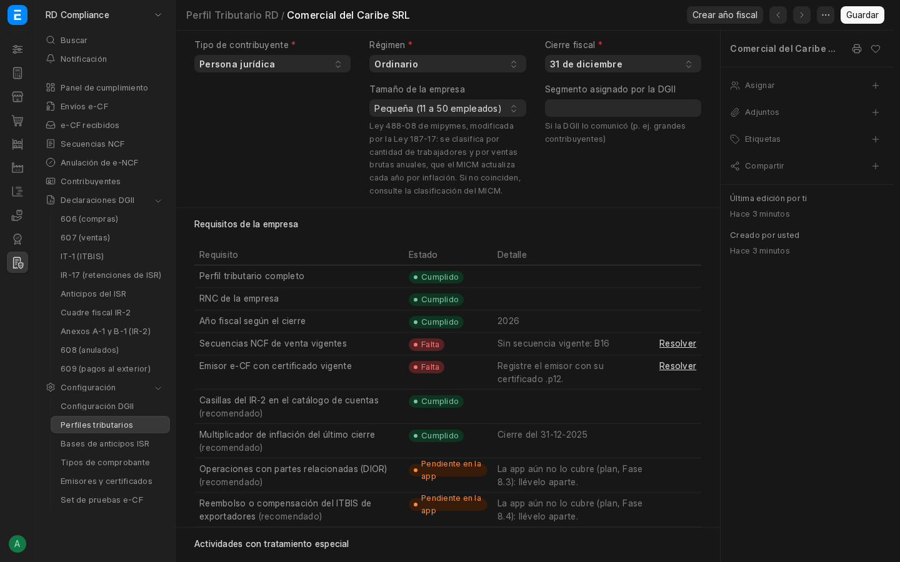

# Publicación en el Marketplace de Frappe

Hay dos vías, y conviene preparar las dos:

1. **Marketplace de Frappe** (registro [`frappe/marketplace`](https://github.com/frappe/marketplace), analizado el 2026-10-20). Es el registro abierto que leen `bench get-app` de [Pilot](https://github.com/frappe/pilot), el nuevo gestor de servidores de Frappe, y la página *Marketplace* de su panel de administración. Una app entra con un PR al registro, y el CI del registro la valida. La sección siguiente es la guía completa.
2. **Frappe Cloud**: la ficha con textos y capturas está más abajo, en «Ficha y textos».

## 1. Marketplace de Frappe (`frappe/marketplace` y Pilot)

### Cómo funciona

- `apps.json`: una entrada con los datos de cada app, que apunta a su archivo de versiones.
- `apps/<app>.json`: las **versiones publicadas** (`releases`). Cada una fija una rama y un commit exacto (SHA de 40 caracteres), con la versión de la app, el rango de Frappe y las dependencias de otras apps del marketplace. Un push a la rama no publica nada: cada versión nueva entra con un PR al registro.
- **Canal:**
  - `stable` es lo normal. Pilot instala la versión `stable` más nueva compatible con la versión de Frappe del bench.
  - `nightly` es solo para una rama de desarrollo que convive con ramas de versión. En nuestro caso, `develop` junto a `version-16`.
- **Una versión por rama:** una rama no puede tener dos versiones con el mismo número. Cada publicación sube `__version__`.
- **CI del registro, en orden; se detiene en el primer fallo:**
  1. **Esquema:**
     - En la entrada: `name`, `title`, `description`, `repo`, `logo_url`, `website`, `documentation`, `category`, `categories` (lista no vacía), `stars` (entero; 0 sirve) y `releases`, que debe ser exactamente `apps/erpnext_rd.json`.
     - En cada versión: `version`, `branch`, `commit`, `frappe_core` y `dependencies` (`{}` sirve, pero la clave tiene que estar).
  2. **Semgrep** con las reglas de `validation/semgrep-rules/`:
     - Los hallazgos *Critical* (ERROR) y *Major* (HIGH), o los marcados `is_blocking`, **bloquean el PR**.
     - Los *Minor* (WARNING) y los *Info* solo se informan.
  3. **Validador de `get-app` de Pilot.** Instala la app en un entorno desechable junto a Frappe de la rama que indica `frappe_core` y revisa:
     - la estructura del repo y la sintaxis;
     - que `hooks.py` apunte a código que existe;
     - las *fixtures* y los enlaces simbólicos;
     - que `required_apps` coincida con `[tool.bench.frappe-dependencies]`;
     - las importaciones, y que las dependencias se puedan resolver junto a las demás apps;
     - que estén publicados los **assets precompilados** del commit.

     Además, rechaza la versión si `version` o `frappe_core` no coinciden con el `pyproject.toml` de ese commit.
- **Informe del CI:** se publica como comentario del PR. Si corriges algo en nuestro repo, comenta `/rereview` en el PR para que vuelva a correr.

### Lo que ya está en el repo

Todo es aditivo: la imagen Docker (`deploy/Containerfile`, Dokploy) y `bench get-app` clásico siguen igual, porque compilan con `bench build` y no leen nada de esto.

**1. `pyproject.toml`.** Sin `[tool.bench.frappe-dependencies]`, Pilot rechaza la app. Coincide con `required_apps = ["frappe/erpnext"]` de `hooks.py`. Frappe HR **no** se declara: es opcional, y si se declarara pasaría a ser obligatorio. `[tool.bench.assets]` describe el Panel RD Compliance (`frontend/`), que compila el script `build` del `package.json` raíz; sin esa tabla, el workflow de assets de Pilot falla.

```toml
[tool.bench.frappe-dependencies]
frappe = ">=16.0.0,<17.0.0"
erpnext = ">=16.0.0,<17.0.0"

[tool.bench.assets]
build_dir = "./frontend"
out_dir = "./erpnext_rd/public/frontend"
index_html_path = "./erpnext_rd/www/rd-compliance.html"
```

Las bibliotecas que importamos de fuera de Python ya vienen con Frappe o ERPNext: `requests`, `lxml`, `cryptography`, `num2words`, `openpyxl`, `pyqrcode`, `holidays`, `python-dateutil` y `werkzeug`. Si algún día se agrega otra, va en `[project].dependencies` con un **rango**, no fijada (`==`), para no chocar con otras apps del mismo bench.

**2. Assets precompilados** (`.github/workflows/assets.yml`). Pilot descarga los assets del commit en vez de compilarlos en el servidor, y el validador del registro **exige** que estén publicados. En cada push a `version-16` o `develop`, el workflow reutilizable de Pilot (`frappe/pilot/.github/workflows/app-assets.yml`) compila contra Frappe `version-16` y sube `erpnext_rd-<commit>.tar.gz` (con su `.sha256`) al release `assets-<rama>` del repo. Se puede lanzar a mano (*Run workflow*).

La compilación no modifica archivos versionados; si lo hiciera (por ejemplo `frontend/yarn.lock`), Pilot dejaría de usar los assets precompilados. La salida (`erpnext_rd/public/frontend/` y `erpnext_rd/www/rd-compliance.html`) está en `.gitignore`. Para probarlo en local (Node.js 24):

```bash
pilot/scripts/build-app-assets.sh <checkout de la app> version-16 <carpeta de salida>
```

**3. Publicación** (`.github/workflows/publish-marketplace.yml`). *Run workflow* sobre `version-16` (canal `stable`) o `develop` (canal `nightly`), **después** de que el workflow de assets termine en ese commit. Usa `frappe/marketplace/.github/workflows/publish-release.yml`: lee la versión, `frappe_core` y las dependencias del `pyproject.toml`, agrega el commit a `apps/erpnext_rd.json` y abre el PR en el registro.

Necesita el secreto `MARKETPLACE_PR_TOKEN`: un token de GitHub del usuario que puede hacer *fork* de `frappe/marketplace`, subir una rama y abrir el PR (PAT *fine-grained* o token de una GitHub App). Va en *Settings → Secrets* del repo; **nunca en el código**.

**4. Semgrep.** El código pasa las reglas del registro sin hallazgos (2026-10-21). El job `semgrep` de `ci.yml` las corre en cada PR con los mismos criterios que el registro (`deploy/ci/semgrep_marketplace.py`): lo *Critical*, *Major* o `is_blocking` falla el CI; los avisos solo se muestran. Excepciones justificadas en el código con `# nosemgrep: <regla>` y el motivo en la línea anterior:
- `frappe-manual-commit`: el padrón hace commit por lote (800 mil registros en la cola `long`) y el panel guarda el token CSRF en una petición GET.
- `frappe-setuser`: el receptor de e-CF pone `Administrator` solo para pasar el `auth_hook` de Frappe y vuelve a `Guest` antes de atender.
- `frappe-security-file-traversal`: lectura de los XSD y las plantillas de la propia app con rutas fijas.

Para revisarlo en local:

```bash
git clone --depth 1 https://github.com/frappe/marketplace .marketplace
docker run --rm -v "$PWD:/src" -w /src semgrep/semgrep:1.140.0 sh -c 'semgrep scan --config .marketplace/validation/semgrep-rules --metrics=off --json --quiet --exclude .marketplace . > /tmp/s.json; python3 deploy/ci/semgrep_marketplace.py < /tmp/s.json'
```

**5. Rama y versión.**
- `version-16` es la rama `stable` que instalarán los benches. Hoy está en `v0.3.0`, que no tiene las tablas del `pyproject.toml`: la primera versión publicable es la siguiente (`0.4.0`).
- Antes de cada publicación hay que subir `__version__` en `erpnext_rd/__init__.py`, porque el validador compara el número publicado con el del commit y una rama no repite número.
- `develop` se puede publicar como `nightly`.

**6. Datos de la entrada.**
- `logo_url`: URL directa a un PNG o SVG cuadrado. Sirve `erpnext_rd/public/images/erpnext_rd_logo.svg` (64 × 64) por su URL *raw* de GitHub en `main`.
- `website`: el repo.
- `documentation`: la guía de uso.

### Borradores de la entrada

`apps.json`, en orden alfabético:

```json
{
  "name": "erpnext_rd",
  "title": "ERPNext RD",
  "description": "Localización de República Dominicana para ERPNext y Frappe HR: NCF y e-CF, reportes DGII, padrón RNC y nómina RD",
  "repo": "https://github.com/daniellora7/ERPNext-DR-Compilance",
  "logo_url": "https://raw.githubusercontent.com/daniellora7/ERPNext-DR-Compilance/main/erpnext_rd/public/images/erpnext_rd_logo.svg",
  "website": "https://github.com/daniellora7/ERPNext-DR-Compilance",
  "documentation": "https://github.com/daniellora7/ERPNext-DR-Compilance/blob/main/docs/GUIA-DE-USO.md",
  "categories": ["Localization", "Compliance", "HR & Payroll"],
  "category": "Compliance",
  "stars": 0,
  "releases": "apps/erpnext_rd.json"
}
```

`apps/erpnext_rd.json`, con la primera versión. Si se usa el workflow de publicación, este archivo se crea en el PR inicial y el workflow agrega las siguientes versiones:

```json
{
  "name": "erpnext_rd",
  "releases": [
    {
      "version": "0.4.0",
      "branch": "version-16",
      "commit": "<SHA completo del commit en version-16>",
      "frappe_core": ">=16.0.0,<17.0.0",
      "dependencies": {"erpnext": ">=16.0.0,<17.0.0"},
      "channel": "stable"
    }
  ]
}
```

ERPNext y Frappe HR ya están en el registro (`erpnext`, `hrms`). Las localizaciones de otros países (México, Ecuador, Alemania, Kenia) usan `category: "Compliance"`.

### Pasos para publicar (cuando el usuario lo pida)

1. Subir `__version__` (p. ej. `0.4.0`), pasar «Sin publicar» del `CHANGELOG.md` a esa versión, fusionar `develop` en `main` y llevar `main` a `version-16`. Crear el tag `v0.x.y` (publica la imagen en GHCR).
2. Esperar a que «Assets precompilados» termine en `version-16` y publique `erpnext_rd-<commit>.tar.gz` en el release `assets-version-16`.
3. Primera vez: fork de `frappe/marketplace`; agregar la entrada a `apps.json` y crear `apps/erpnext_rd.json` con la versión (borradores arriba); abrir el PR. Las siguientes veces: *Run workflow* en «Publicar en el Marketplace de Frappe» (necesita `MARKETPLACE_PR_TOKEN`).
4. Revisar el comentario del CI en el PR. Corregir lo que bloquee y comentar `/rereview`.

## 2. Ficha y textos (Frappe Cloud y Marketplace de Frappe)

Textos y lista de lo que falta para publicar ERPNext RD. Requisitos técnicos: `docs/PLAN.md`, Fase 7.

### Textos

**Nombre:** ERPNext RD

**Descripción corta:** Localización de República Dominicana para ERPNext y Frappe HR: NCF y e-CF, reportes DGII, padrón RNC y nómina RD.

**Descripción larga:**

ERPNext RD adapta ERPNext y Frappe HR a la República Dominicana sin modificar su código.

- **Comprobantes fiscales:** secuencias NCF sin duplicados en ventas, compras y POS; validación de RNC y cédula con el padrón de la DGII; catálogo de cuentas DGII.
- **Facturación electrónica (e-CF):** XML de los diez tipos y del resumen de consumo según los esquemas oficiales, firma digital con el certificado de la empresa, envío a la DGII con contingencia y entrega al comprador; recepción de e-CF de proveedores con acuse y aprobación comercial; anulación de rangos y set de pruebas para la certificación.
- **Declaraciones DGII:** formatos 606, 607, 608 y 609 con su archivo TXT, y resúmenes del IT-1 e IR-17; anticipos del ISR y cuadre fiscal del IR-2 con depreciación fiscal, ajuste por inflación y anexos A-1 y B-1.
- **Nómina RD (con Frappe HR):** AFP, SFS (con dependientes adicionales), ISR e INFOTEP; prestaciones, vacaciones, regalía y bonificación; subsidios de la SISALRIL; archivos de la TSS (AM, NV, RT), IR-3, IR-13 y planillas del Ministerio de Trabajo.
- **Panel de cumplimiento:** plazos y montos del mes en una pantalla.

Cubre a las personas jurídicas del régimen ordinario; los regímenes e impuestos especiales están en desarrollo. Todas las tasas y escalas se editan en la configuración. Solo actúa en empresas con país República Dominicana, así que convive con empresas de otros países. Frappe HR es opcional.

**Categorías:** Localization, Accounting, HR & Payroll (en el registro de Frappe: `category` = `Compliance`).

**Licencia:** GPL-3.0. **Código:** https://github.com/daniellora7/ERPNext-DR-Compilance

**Documentación:** https://github.com/daniellora7/ERPNext-DR-Compilance/blob/main/docs/GUIA-DE-USO.md

**Soporte:** https://github.com/daniellora7/ERPNext-DR-Compilance/issues (plantillas de error y de sugerencia en `.github/ISSUE_TEMPLATE/`).

### Capturas (tema oscuro, 1440 × 900)

Tomadas en un sitio de demostración con empresas y datos ficticios: un mes registrado con la prueba de punta a punta (`erpnext_rd/tests/test_punta_a_punta.py`). Actualizadas el 2026-10-20.

| Captura | Archivo |
|---|---|
| RD Compliance: panel de cumplimiento con los plazos del mes | `docs/capturas/rd-compliance.png` |
| Factura Fiscal RD (crédito fiscal B01) | `docs/capturas/factura-fiscal-rd.png` |
| Nómina RD: autodeterminación de la TSS | `docs/capturas/nomina-rd.png` |
| Volante de pago RD | `docs/capturas/volante-pago-rd.png` |
| Perfil tributario de la empresa con sus requisitos | `docs/capturas/perfil-tributario.png` |




Opcionales para más adelante: formato 606 y envío e-CF aceptado (con el certificado real).

### Pendiente (ficha)

- [x] Rama `version-16` (Frappe Cloud y el registro instalan por rama): ya existe en GitHub.
- [x] Tag `v0.3.0` (primera versión, en `version-16`). La siguiente, `v0.4.0`, es la primera que puede ir al registro.
- [x] Lo que exige el registro `frappe/marketplace` en el repo (sección 1): `pyproject.toml`, assets precompilados, Semgrep sin hallazgos y en el CI, workflow de publicación.
- [ ] Publicar la primera versión en el registro (`0.4.0`) y el secreto `MARKETPLACE_PR_TOKEN`.
- [x] CI público en verde en cada PR.
- [x] Capturas en tema oscuro con datos ficticios (`docs/capturas/`).
- [x] Enlace de soporte (issues de GitHub con plantillas) y documentación de uso (`docs/GUIA-DE-USO.md`).
- [x] Padrón RNC medido: descarga 46 s (zip de 23 MB) e importación de 793 985 registros en 3 min 16 s con 154 MB de memoria pico, en la cola `long`.
- [x] Logo: `erpnext_rd/public/images/erpnext_rd_logo.svg` (`app_logo_url`).
- [x] Instala sin acceso a la máquina, funciona sin Frappe HR y se desinstala limpio.
